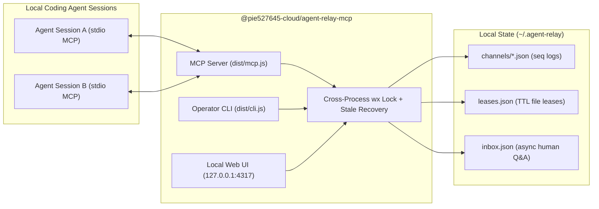

# @pie527645-cloud/agent-relay-mcp

Local-first cross-session coding agent bridge, cooperative file-lease guard, and non-blocking human question inbox built on the Model Context Protocol (MCP).

When running multiple coding agents side by side on the same workstation (such as terminal sessions, IDE agents, and background workers), sessions ordinarily cannot see what sibling sessions are editing and stall whenever they block waiting for human terminal input. `agent-relay-mcp` solves these three coordination gaps using an atomic local JSON store with zero cloud dependencies and zero native C++ addons:

1. **Monotonic Channel Relay** (`post_message`, `read_messages`) — Lightweight append-only local channels with strictly monotonic sequence numbers (`seq`) and cursor-based polling (`sinceSeq`).
2. **Cooperative File-Lease Guard** (`acquire_file_lease`, `release_file_lease`) — Exclusive time-bounded file leases (default 120s TTL, max 3600s) that prevent two agents from editing the same file simultaneously, automatically expire stale leases, and report active lease holders on conflict instead of silently overwriting.
3. **Non-Blocking Human Question Inbox** (`ask_human_async`, `check_human_reply`) — Agents enqueue questions and continue unblocked work while a human operator answers asynchronously from the `agent-relay` CLI or the local `127.0.0.1` web dashboard.

---

## Architecture



---

## Requirements

- **Node.js** `>= 20.18.1` (tested in CI across Ubuntu and Windows on Node `20.x` and `22.x`)
- Pure TypeScript / JavaScript runtime dependencies (`@modelcontextprotocol/sdk`, `zod`) — **zero `node-gyp` or native C++ compilation required**

---

## Installation From Source

Clone the repository, install dependencies, and compile the TypeScript build:

```bash
git clone https://github.com/pie527645-cloud/agent-relay-mcp.git
cd agent-relay-mcp
npm install
npm run build
```

Verify both entrypoints after building:

```bash
node ./dist/cli.js --help
node ./dist/mcp.js --help
```

---

## Configuring MCP Clients

Point your MCP-compatible coding client to the compiled `dist/mcp.js` entrypoint using an absolute path.

### Claude Desktop / Cursor / Windsurf (`mcpServers` JSON)

```json
{
  "mcpServers": {
    "agent-relay": {
      "command": "node",
      "args": [
        "/abs/path/to/agent-relay-mcp/dist/mcp.js"
      ],
      "env": {
        "AGENT_RELAY_DIR": "/Users/yourname/.agent-relay"
      }
    }
  }
}
```

On Windows, use your Windows path (for example `"C:\\path\\to\\agent-relay-mcp\\dist\\mcp.js"`). You may omit `AGENT_RELAY_DIR` to use the default `~/.agent-relay` directory, or pass `"--dir", "/custom/state/path"` in `args`.

---

## MCP Tools Reference (6 Tools)

### 1. `post_message`

Append a timestamped message with a monotonic sequence number (`seq`) to a local coordination channel.

- **Parameters:**
  - `channel` (`string`, required): Channel identifier matching `[a-zA-Z0-9_-]{1,64}`.
  - `sender` (`string`, required): Identifier of the agent or session posting the message (`1..128` chars).
  - `body` (`string`, required): Plain-text message content (`1..32768` chars).
  - `tags` (`string[]`, optional): Up to 16 classification tags (`1..64` chars each).
- **Returns:** `{ message: { seq, channel, sender, body, tags, createdAt }, headSeq }`

### 2. `read_messages`

Read channel messages strictly after `sinceSeq` along with the latest `headSeq` cursor.

- **Parameters:**
  - `channel` (`string`, required): Channel identifier matching `[a-zA-Z0-9_-]{1,64}`.
  - `sinceSeq` (`integer`, optional, default `0`): Return messages where `seq > sinceSeq`.
  - `limit` (`integer`, optional, default `50`, max `500`): Maximum messages returned in ascending `seq` order.
- **Returns:** `{ channel, sinceSeq, headSeq, count, hasMore, messages }`

### 3. `acquire_file_lease`

Claim or renew an exclusive cooperative lease on a workspace file path.

- **Parameters:**
  - `path` (`string`, required): Workspace-scoped file path (normalized across `/` and `\`; rejects `..` traversal, UNC paths, and control characters).
  - `owner` (`string`, required): Identifier of the requesting session (`1..128` chars).
  - `ttlSeconds` (`integer`, optional, default `120`, range `1..3600`): Lease duration before automatic expiration.
- **Behavior:**
  - Automatically prunes expired leases before evaluating conflicts.
  - Re-acquiring a lease already held by the same `owner` renews its `expiresAt` timestamp (`renewed: true`).
  - If held by another active owner, returns `{ acquired: false, renewed: false, path, holder, expiresAt }` without overwriting the existing lease.

### 4. `release_file_lease`

Release a cooperative file lease cleanly when editing finishes.

- **Parameters:**
  - `path` (`string`, required): Leased file path.
  - `owner` (`string`, required): Lease owner identifier.
- **Behavior:** Verifies ownership before removing an active lease; idempotently succeeds (`alreadyExpiredOrMissing: true`) if the lease already expired.

### 5. `ask_human_async`

Enqueue a non-blocking question in the shared human inbox and return immediately without reading or blocking terminal `stdin`.

- **Parameters:**
  - `sender` (`string`, required): Agent or session asking the question.
  - `question` (`string`, required): Question text (`1..8192` chars).
  - `options` (`string[]`, optional): Up to 20 suggested answer choices.
  - `priority` (`"low" | "normal" | "high" | "urgent"`, optional, default `"normal"`).
- **Returns:** `{ questionId, status: "pending", priority, createdAt }`

### 6. `check_human_reply`

Poll the status of a previously queued human question by `questionId`.

- **Parameters:**
  - `questionId` (`string`, required): Identifier returned by `ask_human_async`.
- **Returns:** `{ questionId, status: "pending" | "answered", sender, question, options, priority, createdAt, answer, answeredAt }`

---

## Operator CLI Reference

Run commands directly via `node /abs/path/to/agent-relay-mcp/dist/cli.js` (or `agent-relay` if linked locally via `npm link`). Every command supports `--dir <path>` and `--json`.

```bash
# View pending human questions and active cooperative file leases
node ./dist/cli.js inbox

# Include previously answered questions and emit JSON
node ./dist/cli.js inbox --all --json

# Reply to a queued agent question
node ./dist/cli.js reply q_m8abc12_9f01c2d3 "Use the expand-contract migration."

# Tail recent messages in a channel (or pass --since <seq> --limit <n>)
node ./dist/cli.js tail backend --limit 20

# Inspect active file leases or release a specific lease
node ./dist/cli.js leases
node ./dist/cli.js leases --release src/auth/middleware.ts --owner claude-code

# Launch the local-only HTTP dashboard on 127.0.0.1:4317
node ./dist/cli.js web --port 4317
```

---

## Security and Concurrency Design

- **Cross-Process Atomic State:** State mutations acquire an exclusive `'wx'` (`O_CREAT | O_EXCL`) lockfile per resource with jittered retry backoff and automatic stale/dead-PID lock eviction, then write to a process-unique temporary file, `datasync` to disk, and atomically rename into place.
- **Strict Input & Path Sanitization:** Channel names are restricted to `[a-zA-Z0-9_-]{1,64}`. File lease keys normalize slashes and reject parent directory traversal (`..`), null/control characters, UNC paths, and NTFS alternate data stream colons.
- **Localhost-Only Web UI Hardening:** `agent-relay web` binds strictly to `127.0.0.1` (never `0.0.0.0`), validates `Host` (`127.0.0.1:<port>`, `localhost:<port>`, `[::1]:<port>`), `Origin`, `Referer`, and `Sec-Fetch-Site` headers (returning HTTP `403 Forbidden` on untrusted values to block DNS rebinding and cross-site form submissions), applies a strict `Content-Security-Policy` (`default-src 'none'`), and HTML-escapes all rendered text against XSS.

---

## Development and Verification

```bash
npm run lint
npm run build
npm test
```

## License

MIT
